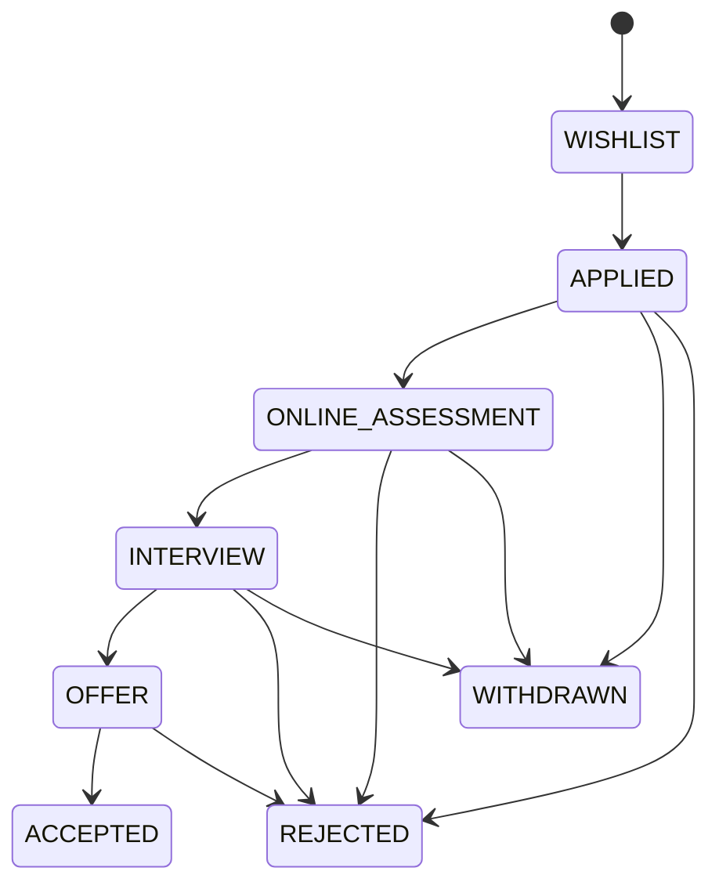

# Job Application Tracker

A REST API for tracking job and internship applications, with a validated
status workflow, full status history, and funnel statistics.

Built with Java 17, Spring Boot, PostgreSQL and Docker.

## Features
- CRUD for applications, with filtering by status, location and date
- Status workflow with enforced transitions (illegal moves return `409`)
- Append-only status history for every application
- Statistics: applications per status, conversion funnel

## Quick start

Requirements: Java 17, Docker.

```bash
docker compose up -d        # starts PostgreSQL
./gradlew bootRun           # starts the API on http://localhost:8080
```

## Example

Create an application:
```bash
curl -X POST localhost:8080/applications \
  -H "Content-Type: application/json" \
  -d '{"companyId": "1", "location": "Amsterdam"}'
```

Move it to the next stage:
```bash
curl -X POST localhost:8080/applications/1/status \
  -H "Content-Type: application/json" \
  -d '{"status": "INTERVIEW"}'
```

Response (shortened):
```json
{
  "id": 1,
  "company": "Optiver",
  "status": "INTERVIEW",
  "history": [
    {"fromStatus": "APPLIED", "toStatus": "INTERVIEW", "changedAt": "2026-11-12T09:30:00Z"}
  ]
}
```

## Status workflow



## Architecture
Controller -> Service -> Repository -> PostgreSQL

- Controllers handle HTTP only and return DTO records, never entities
- Services hold the business rules and run inside transactions

## Design decisions
- **Status history is a separate append-only table**, not just a status column,
  so timing statistics (time in each stage) can be calculated.
- **Status changes go through one endpoint**, so every change is validated and
  recorded in the same transaction.
- **Funnel stats count applications that ever reached a stage**, taken from the
  history, so the numbers don't shrink as applications move on.
- (Add one or two of your own, with the reason.)

## Limitations and next steps
- Single user, no authentication yet
- No frontend
- Planned: reminder emails, email parsing